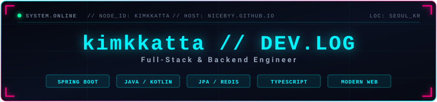

<div align="center">

  <!-- Self-hosted Cyberpunk Header Banner -->
  <a href="https://nicebyy.github.io">
    
  </a>

  <br/><br/>

  <!-- Dynamic Typing Console -->
  <a href="https://nicebyy.github.io">
    
  </a>

  <br/>

  <!-- Quick Status Badges -->
  <a href="https://nicebyy.github.io">
    
  </a>
  &nbsp;
  <a href="https://github.com/nicebyy">
    
  </a>
  &nbsp;
  
  &nbsp;
  

</div>

<br/>

### 🛰️ Terminal Status & Bio

```yaml
# ─── [ SYSTEM.STATUS // NODE_INFO ] ──────────────────────────────────────────
operator: kimkkatta
handle: nicebyy
role: Full-Stack & Frontend Developer
location: Seoul, South Korea
interests:
  - Interactive Web Interfaces & Modern Frontend (Next.js / TypeScript)
  - Robust Backend Architecture & Concurrency Control (Spring Boot / JPA / Redis)
  - Algorithm Optimization & Data Structures (BOJ / Programmers)
mission: "코드로 문제를 해결하고, 실험적인 웹 인터페이스와 아키텍처를 탐구합니다."
status: "SYSTEM.ONLINE // READY_TO_BUILD"
# ─────────────────────────────────────────────────────────────────────────────
```

---

### ⚡ Tech Stack & Capabilities

<table>
  <tr>
    <td align="center" width="22%"><b>Frontend & Web</b></td>
    <td>
      
      
      
      
      
      
      
    </td>
  </tr>
  <tr>
    <td align="center"><b>Backend & Core</b></td>
    <td>
      
      
      
      
      
      
      
    </td>
  </tr>
  <tr>
    <td align="center"><b>DevOps & Tools</b></td>
    <td>
      
      
      
      
      
    </td>
  </tr>
</table>

---

### 📊 Real-Time GitHub Analytics

<div align="center">
  <table border="0">
    <tr>
      <td align="center" valign="middle">
        <a href="https://github.com/nicebyy">
          
        </a>
      </td>
      <td align="center" valign="middle">
        <a href="https://github.com/nicebyy">
          
        </a>
      </td>
    </tr>
  </table>

  <br/>

  <a href="https://github.com/nicebyy">
    
  </a>
</div>

---

### 📝 Featured Engineering Logs ([kimkkatta // DEV.LOG](https://nicebyy.github.io))

<table>
  <tr>
    <td width="33%" valign="top">
      <h4>⚙️ Spring & Backend Systems</h4>
      <ul>
        <li><a href="https://nicebyy.github.io/posts/spring-concurrency-redisson-mysql-named-lock/"><b>Spring 동시성 제어</b></a><br/><sub>Redisson 분산 락 vs MySQL Named Lock</sub></li>
        <li><a href="https://nicebyy.github.io/posts/spring-security-setup/"><b>Spring Security 아키텍처</b></a><br/><sub>보안 필터 체인 및 인증 메커니즘</sub></li>
        <li><a href="https://nicebyy.github.io/posts/spring-webflux-introduction/"><b>Spring WebFlux 입문</b></a><br/><sub>리액티브 스트림과 Non-blocking I/O</sub></li>
      </ul>
    </td>
    <td width="33%" valign="top">
      <h4>🗄️ JPA & Persistence</h4>
      <ul>
        <li><a href="https://nicebyy.github.io/posts/jpa-overview-persistence-context/"><b>JPA 영속성 컨텍스트 심층 분석</b></a><br/><sub>1차 캐시, 쓰기 지연, 변경 감지 메커니즘</sub></li>
        <li><a href="https://nicebyy.github.io/posts/jpa-persistence-context-identity/"><b>JPA 동일성과 생명주기</b></a><br/><sub>영속성 컨텍스트 엔티티 식별성 보장</sub></li>
        <li><a href="https://nicebyy.github.io/posts/spring-boot-datasource-encryption/"><b>DataSource 암호화 및 보안</b></a><br/><sub>실무 환경 DB 자격증명 암호화 패턴</sub></li>
      </ul>
    </td>
    <td width="33%" valign="top">
      <h4>💡 Algorithms & Problem Solving</h4>
      <ul>
        <li><a href="https://nicebyy.github.io/posts/boj-9328-key/"><b>BOJ 9328 열쇠</b></a><br/><sub>BFS 상태 탐색 및 비트마스킹</sub></li>
        <li><a href="https://nicebyy.github.io/posts/programmers-176962-homework-progress/"><b>프로그래머스 과제 진행하기</b></a><br/><sub>스택 기반 시뮬레이션 최적화</sub></li>
        <li><a href="https://nicebyy.github.io/posts/spring-redisson-remote-service/"><b>Redisson Remote Service 활용</b></a><br/><sub>분산 RPC 호출과 이벤트 버스</sub></li>
      </ul>
    </td>
  </tr>
</table>

---

### 📬 Connect & Contact

<div align="center">

  <a href="https://nicebyy.github.io" target="_blank">
    
  </a>
  &nbsp;
  <a href="https://github.com/nicebyy" target="_blank">
    
  </a>
  &nbsp;
  <a href="mailto:nicebyy@naver.com">
    
  </a>

  <br/><br/>

  <sub>⚡ Powered by <b>kimkkatta</b> // Built with Cyberpunk Neon Aesthetic &amp; Next.js</sub>

</div>
